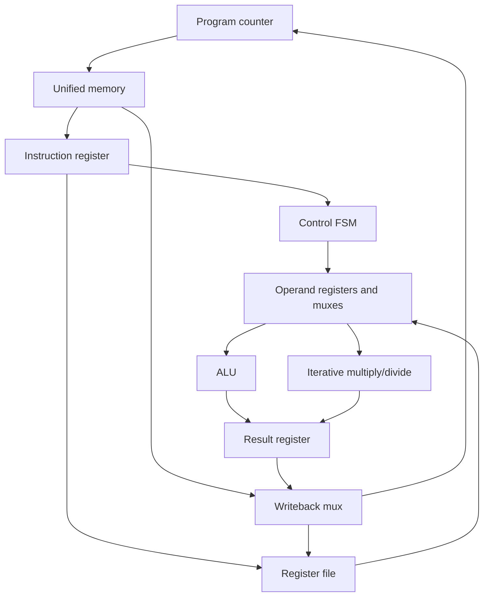

# 32-bit Multicycle RISC-V Processor

SystemVerilog coursework processor with a finite-state controller, shared instruction/data memory, register file, ALU and iterative multiply/divide unit. The top module is `top_processor` in `Top.sv`. This is a multicycle design, not a pipelined CPU.

## Run the simulation

Install Icarus Verilog (SystemVerilog support), GNU Make and optionally GTKWave. On Ubuntu/Debian:

```sh
sudo apt install iverilog make gtkwave
make test
make sim
gtkwave build/processor.vcd
```

Run from the repository root because `$readmemh` loads `reg.mem` and `unified_memory.mem` relative to the working directory. Memory files contain hexadecimal words without a `0x` prefix. `tb.sv` supplies a 10 ns clock, resets for 20 ns and runs for another 2500 ns. The monitor prints PC, instruction, ALU and multiply/divide outputs.

`make test` is self-checking: arithmetic/shift/compare results and register-file writes, including immutable x0. `make sim` is a waveform/smoke run of the included program, **not** an ISA compliance test. The memory image initializes only its listed words; execution beyond them is undefined. A short-file `$readmemh` warning is expected with the existing image.

## Datapath



## Source guide

| Files | Role |
|---|---|
| `Control.sv` | Fetch/decode/execute/memory/writeback states; waits for `mult_ready` |
| `Top.sv` | Connects the datapath |
| `ALU.sv`, `alu_control.sv` | Arithmetic/logic and operation decode |
| `Mul.sv`, `mul_mux.sv`, `mux_mul.sv` | Iterative arithmetic and result selection |
| `reg.sv`, `data_reg.sv` | Register file and operand registers |
| `Unified_mem.sv` | 4096 × 32-bit words (16 KiB), indexed by address bits 13:2 |
| `Instruction_reg.sv`, `immediate_gen.sv` | Instruction/old-PC storage and immediates |
| Remaining mux/register modules | ALU input, address, PC and writeback paths |

## Instruction scope

The controller routes register ALU operations, immediate ALU operations, loads, stores, branches, JAL and funct7=1 multiply/divide operations. The ALU contains ADD/SUB, AND/OR/XOR, SLT/SLTU, SLL/SRL/SRA. The M-unit decodes MUL/MULH/MULHSU/MULHU and DIV/DIVU/REM/REMU and normally performs 32 iterative steps plus state overhead.

**Decode coverage is not proof of correct ISA support.** The current implementation should be described as an educational RV32 subset with experimental M arithmetic, rather than a compliant RV32IM implementation.

## Known correctness and hardware limits

- Immediate-operation decoding shares `funct7` handling with register operations, so some immediate bit patterns can select the wrong operation.
- All branch opcodes take the BEQ path; loads/stores do not distinguish byte/halfword variants. JALR, LUI, AUIPC, exceptions and privileged instructions are absent.
- The multiplier's upper-half addition does not retain an extra carry bit; full-range unsigned multiply needs correction and regression coverage.
- Signed REM operand preparation and division for large unsigned divisors need correction/edge-case tests. M decode alone does not establish correctness.
- Memory silently indexes by bits 13:2, ignoring alignment and upper address bits; register initialization uses a file rather than a reset port.
- No synthesis timing, FPGA utilization, power or maximum-frequency results are included.

## Verification roadmap

Add instruction-level expected-result programs for load/store, taken/not-taken branches and JAL; then cover signed/unsigned M arithmetic, divide-by-zero, overflow and back-to-back operations. Compare against a reference ISA model before claiming compliance. Keep waveforms and reproducible synthesis reports with the exact target and tool version.

The original project PDFs are retained for context. No authorship split, license or performance claim is inferred from the source.
